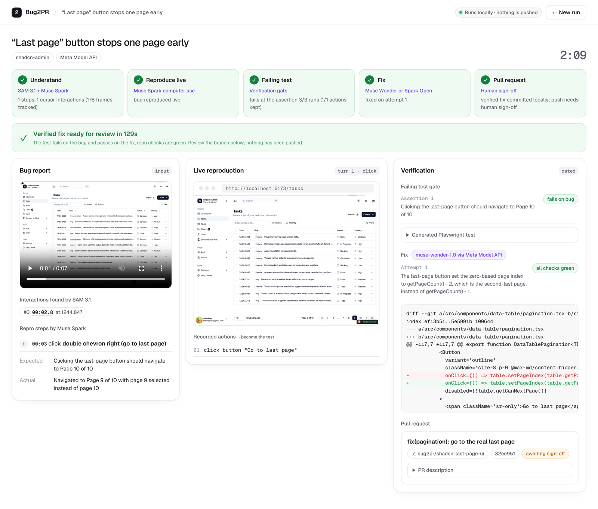

# Bug2PR

**Turn a screen recording of a web bug into a reproduced failing test and a verified pull request.**

Bug reports are usually vague ("checkout is broken, see video"), and someone has to watch the recording, guess the steps and try to reproduce it before any fix can start. Bug2PR takes any `.mp4` screen recording, works out what the user did, reproduces the bug live in a real browser, writes a regression test that fails because of the bug, fixes the code until that test passes while the repo's own checks stay green, and prepares a pull request for a human to approve.

Built for the **Meta Global AI Developer Hackathon** (Oct 26 – Nov 4, 2026), Indie track, theme *Build for Your World*.

```
 screen recording ──► Understand ──► Reproduce live ──► Failing test ──► Fix ──► Pull request
   (.mp4)            SAM 3.1 +       Muse Spark         verification     Muse Wonder   human
                     Muse Spark      computer use       gate             or Muse Spark sign-off
                                                                         Open (open weights)
```



## For judges: 5-minute tour

1. **Watch the demo video (3 min):** [youtu.be/mkzIdOfx0JE](https://youtu.be/mkzIdOfx0JE). Every run in it is real; nothing is mocked.
2. **See one complete run without installing anything:** [docs/sample-runs/shadcn-search-by-id/](docs/sample-runs/shadcn-search-by-id/). It holds everything the models produced for one bug video:
   - `repro-steps-from-video.json`: SAM 3.1 cursor interactions and the steps Muse Spark extracted from [the video](eval/bugs/shadcn-search-by-id/video.mp4);
   - `regression-test.spec.ts`: the Playwright test generated from the live computer-use replay. It fails on the bug 3/3 times;
   - `fix-muse-wonder.diff` and `fix-muse-spark-open.diff`: the fix from Muse Wonder (Meta Model API) and from open-weight Muse Spark Open (private mode);
   - `pull-request.md`: the PR description with all the evidence.

   The [real Actual Budget bug](docs/sample-runs/actual-8475-running-balance/) has the same files.
3. **Check the numbers:** [Results](#results) below, full tables in [docs/eval-results.md](docs/eval-results.md).
4. **Read the core code** (each file is short and commented):

   | Step | File |
   |---|---|
   | SAM 3.1 tracks the cursor → interactions | [`src/pipeline/track-cursor-with-sam.ts`](src/pipeline/track-cursor-with-sam.ts) |
   | Muse Spark: video → grounded repro steps | [`src/pipeline/extract-repro-steps.ts`](src/pipeline/extract-repro-steps.ts) |
   | Muse Spark computer use replays the bug | [`src/pipeline/replay-with-computer-use.ts`](src/pipeline/replay-with-computer-use.ts) |
   | Failing-test gate (3/3 fails, sensitivity check) | [`src/pipeline/reproduce-bug-to-failing-test.ts`](src/pipeline/reproduce-bug-to-failing-test.ts) |
   | Fix loop with repo checks | [`src/pipeline/fix-loop.ts`](src/pipeline/fix-loop.ts) |
   | Gated local PR, push only after sign-off | [`src/pipeline/open-gated-pr.ts`](src/pipeline/open-gated-pr.ts) |
   | Meta Model API vs. open weights on Baseten | [`src/lib/text-completion-providers.ts`](src/lib/text-completion-providers.ts) |
   | Whole pipeline in one function | [`src/pipeline/run-bug2pr.ts`](src/pipeline/run-bug2pr.ts) |

5. **Run it yourself (optional, ~10 min):** see [Run it](#run-it). One command sets up the target app with the seeded bugs.

## How it uses Meta's models

| Step | Model | What it does |
|---|---|---|
| Cursor grounding | **SAM 3.1** (video) | Tracks the mouse cursor through the recording. Cursor dwell + on-screen change marks *where and when* the user interacted. |
| Video understanding | **Muse Spark 1.3** (video input) | Turns the recording plus zoomed before/after crops of each interaction into structured repro steps, expected vs. actual. Every click or typing step must cite a SAM interaction, so it cannot invent clicks. |
| Live reproduction | **Muse Spark 1.3** (computer use) | Drives a real Chromium through Playwright until the bug shows up. Every action is recorded as a stable locator (role + name, not pixels). |
| Expected-behaviour assertion | **Muse Spark 1.3** | Proposes ONE assertion in a small checked DSL. The test code itself is generated deterministically from the recorded actions. |
| Fix | **Muse Wonder 1.0** | Search/replace edits to the shortlisted source files, retried with feedback from failing tests. |
| Private mode | **Muse Spark Open** (open weights, served by Baseten) | Same localization + fix steps on Meta's open-weight model, so source code never goes to a closed API. |

## Verification: the agent has to prove its work

Each stage has a gate the agent cannot skip (the pattern from Meta's *Verifiable Agents* workshop). A rejection goes back to the model with the reason; after a bounded number of rejections (3 assertions, 4 fixes) the run is **escalated to a human** instead of producing a wrong result.

- **Failing test gate**: the generated test must fail *at the expected-behaviour assertion* on the buggy app in 3/3 runs, its locator must match a real element, and it must be **sensitive to the repro steps**. If the test fails identically without the steps, it is not measuring the bug and is rejected. Leading actions are minimized while keeping the identical failure.
- **Fix gate**: the regression test must pass, and the target repo's own checks must stay green (shadcn-admin: `tsc -b` + vitest; Actual: its `accounts` e2e suite). Test files can never be edited.
- **PR gate**: the diff must be small enough to review. The branch and PR description are created locally, and pushing happens only after a person signs off (`pushPullRequest`).
- **Computer-use safety checks**: generic per-action confirmations are acknowledged only on sandboxed localhost/file pages. Anything else stops the run.

## Results

Eval set: 3 seeded bugs in [shadcn-admin](https://github.com/satnaing/shadcn-admin), plus 1 real bug in [Actual Budget](https://github.com/actualbudget/actual) ([#8475](https://github.com/actualbudget/actual/issues/8475): running balance not refreshed after editing a transaction). Full tables are in [docs/eval-results.md](docs/eval-results.md), generated from run artifacts by `npm run eval:summary`. The sample is small, so treat the numbers as indicative.

| Stage | Result |
|---|---|
| Video → steps | SAM-grounded: **95.5% step recall, 0 invented steps, 8/8 correct diagnoses** (video only: 86.4%, 0.38 invented steps/run, 7/8) |
| Live reproduction | **4/4** bugs reproduced by the computer-use agent |
| Failing test | **3/4** valid tests (each also verified to pass on the real fix); 1 escalated to a human; **0 wrong tests accepted** |
| Fix | **3/3** fixed on the first attempt with Muse Wonder **and** with open-weight Muse Spark Open. Every fix passes independent ground truth; for the real Actual bug, that is **the upstream PR's own e2e test**. |
| End to end | Raw video → verified PR branch in **129–152 s** (shadcn-admin bugs, from the demo UI) |

What the gates caught during development: in an early version, two generated tests failed on the buggy app *for the wrong reason*: one asserted on a hidden duplicate label, the other on a column header with the same name as the filter button. Checking those tests against the real fixes exposed both, and that led to the visibility rule, the empty-locator rejection and the sensitivity check above.

## Run it

Requirements: Node ≥ 20, `pnpm`, `ffmpeg`, `git`, a Meta Model API key ([dev.meta.ai](https://dev.meta.ai)), and optionally a Baseten key for private mode.

```bash
git clone https://github.com/lehuubao2909/bug2pr.git && cd bug2pr
npm install
npx playwright install chromium
cp .env.example .env              # add META_API_KEY (and BASETEN_API_KEY for private mode)
npm run setup:targets -- shadcn   # clones shadcn-admin into ../targets and recreates the 3 seeded bug branches
```

Then, in two terminals:

```bash
npm run target:shadcn   # the app with the bug, http://localhost:5173
npm run ui              # Bug2PR, http://localhost:4100
```

Open http://localhost:4100, pick one of the shadcn-admin recordings and press **Run Bug2PR**. A run takes about 2–3 minutes. Bug2PR checks out the sample's bug branch itself, and leaves the verified fix on a local `bug2pr/<id>` branch in `../targets/shadcn-admin`. Nothing is pushed.

- **Private mode** (toggle in the UI) runs localization and the fix on open-weight Muse Spark Open via Baseten.
- **Your own recording:** drop any `.mp4` of a bug in one of the target apps.
- **The real Actual Budget bug** needs the large Actual monorepo: `npm run setup:targets -- actual`, then `npm run target:actual` (http://localhost:3002).
- **Seeded bugs** are stored as patches in `eval/bugs/<id>/bug.patch` on top of a pinned shadcn-admin commit; see `scripts/setup-target-apps.sh`.
- Sanity checks against the Meta Model API: `npm run smoke:video`, `npm run smoke:computer-use`, `npm run smoke:sam`.

Evals:

```bash
npm run eval:record    # record the eval bug videos (needs the target dev servers)
npm run eval:gold      # gold specs: must fail on bug branches, pass on fixed code
npm run eval:extract -- --runs 2
npm run eval:replay
npm run eval:fix                                    # Muse Wonder via Meta Model API
FIX_PROVIDER=baseten LOCALIZE_PROVIDER=baseten npm run eval:fix   # Muse Spark Open via Baseten
npm run eval:summary
```

## Code map

| Path | Purpose |
|---|---|
| `src/pipeline/track-cursor-with-sam.ts`, `detect-interactions-from-cursor-track.ts` | SAM 3.1 cursor tracking → interactions |
| `src/pipeline/extract-repro-steps.ts` | Muse Spark video → repro steps (grounded or video-only) |
| `src/pipeline/replay-with-computer-use.ts`, `src/lib/stable-locator-at-point.ts` | Computer-use replay; pixel clicks → stable locators |
| `src/pipeline/propose-expected-assertion.ts`, `codify-failing-test.ts`, `reproduce-bug-to-failing-test.ts` | Assertion DSL, deterministic spec codegen, failing-test gate |
| `src/pipeline/localize-bug-files.ts`, `fix-loop.ts`, `open-gated-pr.ts` | Localization, fix loop, gated PR |
| `src/lib/text-completion-providers.ts` | Meta Model API vs. Baseten open weights (private mode) |
| `src/pipeline/run-bug2pr.ts`, `src/ui/` | End-to-end orchestrator and demo UI |
| `eval/bugs/<id>/` | Eval bugs: `video.mp4`, `truth.json`, `gold.spec.ts`, `bug.patch` (seeded bugs) |
| `scripts/setup-target-apps.sh` | Clones the target apps and recreates the bug branches |
| `docs/sample-runs/` | Saved outputs of real runs (steps, test, fixes, PR) |

## Built during the hackathon

All code in this repository was written during the hackathon (first commit Oct 29, 2026; see `git log`). The development plan, research and design notes were prepared before kickoff without code.

- `src/lib/normalize-sam-response-stream.ts` is adapted from Meta's [meta-model-cookbook](https://github.com/meta-models/meta-model-cookbook) (MIT).
- shadcn-admin (MIT) and Actual Budget (MIT) are used only as external target apps; they are not included here. The seeded bugs are small patches in `eval/bugs/<id>/bug.patch`; the Actual bug is the real upstream commit before the fix.
- The eval videos were recorded with Playwright and a drawn cursor (`npm run eval:record`).

## License

MIT, see [LICENSE](LICENSE).

## Limitations

- Small eval set (4 bugs). The computer-use agent sometimes takes detours (5–17 turns on the same bug), and minimization only trims leading actions.
- For Actual, both models found the right root cause, but they wrote a delta update instead of reusing the existing `calculateBalances()` helper used upstream. This is exactly why the PR waits for human review.
- Eval videos use a large drawn cursor; small native OS cursors are not yet evaluated.
- Target apps run locally, not in an isolated sandbox.
